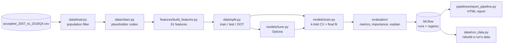

# Architecture: how the model was built

This document explains the design decisions behind the loan default model, from the raw LendingClub
file to the selected model, and how the code is organised. For setup and commands, see
[README.md](README.md).

## 1. Problem

Predict, **at application time**, the probability that a LendingClub loan will be charged off
(probability of default, PD). The score can drive an approve / decline decision or feed pricing and
expected-loss estimates.

- **Target `Default`:** 1 = Charged Off, 0 = Fully Paid (including the "Does not meet the credit
  policy" variants of both).
- **Only information available before funding may be used.** Anything recorded after the loan was
  issued (payments, recoveries, later FICO, hardship, settlements) leaks the outcome.

## 2. Data

| File | Source | Role |
|---|---|---|
| `accepted_2007_to_2018Q4.csv` (2.26M loans × 151 columns, 1.6 GB) | [Kaggle: All Lending Club loan data](https://www.kaggle.com/datasets/wordsforthewise/lending-club) (CC0) | **Training source.** Every model is built from this file. |
| `LC_loans_granting_model_dataset.csv` (1.35M loans × 15 columns) | [Zenodo record 11295916](https://zenodo.org/records/11295916) | Earlier, reduced version of the same loans. Explored in notebook 01; notebook 02 reverse-engineers how it was built from the original file. Used only as a benchmark (`baseline` feature set). |
| `LCDataDictionary.xlsx` | [LendingClub](https://resources.lendingclub.com/LCDataDictionary.xlsx) ([figshare mirror](https://figshare.com/articles/dataset/Lending_club_dataset_description/20016077)) | Column descriptions. Its *browseNotes* sheet lists the fields shown to investors before funding, which is the evidence for "known at application". |

**Why the 151-column file and not the 15-column one.** Notebook 02 showed that the 15-column file
drops `term` (the strongest single feature) and most of the 99 application-time columns. Adding
them back raised OOT AUC from 0.655 to 0.702 (section 8).

[`data_dictionary.csv`](data_dictionary.csv), built by
[`scripts/build_data_dictionary.py`](scripts/build_data_dictionary.py), classifies all 151 columns:
99 application, 38 post-origination leakage, 9 lender decision, 3 identifiers, `issue_d` and
`loan_status`.

## 3. Population (rows)

LendingClub's file is a snapshot taken at the end of 2018. Loans issued late had mostly not finished,
and the ones that had finished are biased towards early defaults and early pay-offs. The population is
therefore restricted to **vintages that had fully resolved**:

| Step | Loans left | Removed | Why |
|---|---|---|---|
| Raw file | 2,260,701 | | |
| Remove footer rows | 2,260,668 | 33 | "Total amount funded…" summary lines |
| Resolved loans only | 1,348,059 | 912,609 | Current, late or in-grace loans have no final outcome |
| Issued from 2013-01 | 1,252,157 | 95,902 | Most bureau features are only filled in from 2013 |
| Fully matured vintages | **580,400** | 671,757 | 36-month loans issued ≤ 2015-12; 60-month loans issued ≤ 2013-12 |

Default rate in the final population: **14.7%**. The full funnel, with reasons, is in
[`reports/data_funnel.html`](reports/data_funnel.html). The rules live in `data.population` in
[`configs/config.yaml`](configs/config.yaml) and are applied by
[`data/load.py`](src/loan_approval/data/load.py).

## 4. Features (columns)

From 151 raw columns to **61 model features** (57 numeric, 4 categorical):

| Step | Columns left | Removed |
|---|---|---|
| Raw columns | 151 | |
| Post-origination leakage | 113 | 38: payments, recoveries, `last_fico_*`, hardship, settlement |
| Lender decisions | 104 | 9: `grade`, `sub_grade`, `int_rate`, `installment`, funded amounts… LendingClub's own risk verdict, not borrower data |
| Identifiers | 101 | `id`, `member_id`, `url` |
| Target source and issue date | 99 | `loan_status` becomes the target; `issue_d` drives the population and split |
| Free text / high cardinality | 96 | `desc`, `title`, `zip_code` |
| Joint-application fields | 79 | 17 columns, empty in the matured population |
| Fields only collected from 2016 | 65 | 14 columns, ~97% empty here |
| Near-duplicates (ρ > 0.95) | 62 | `num_sats`, `tot_hi_cred_lim`, `num_rev_tl_bal_gt_0` |
| Combine FICO bounds | **61** | `fico_range_low` + `fico_range_high` become `fico` (midpoint) |

**Derived features** ([`features/build_features.py`](src/loan_approval/features/build_features.py)):
`term_months`, `fico`, `emp_length_years`, `emp_title_missing` (a missing job title is itself a risk
signal) and `credit_history_months` (from `earliest_cr_line` to the issue date). Every transformation
is row-wise with no fitted state, so it is safe to apply before splitting.

**Cleaning** ([`data/clean.py`](src/loan_approval/data/clean.py)): placeholder codes become NaN
(`dti` −1 / 999, `mo_sin_old_il_acct` 999, `total_rev_hi_lim` 9,999,999), as does `revol_util` above
500%. Other missing values are left as NaN; XGBoost learns a default direction for them.

**Categoricals** (`home_ownership`, `verification_status`, `purpose`, `addr_state`) use XGBoost's
native categorical support. Levels are fixed to those seen in training; unseen levels become NaN.

Feature sets are declared in `features.sets` in the config: `full` (the 61 above) and `baseline`
(the equivalent of the 15-column file). A set can extend another with `base:` and `exclude:`.

## 5. Validation design

| Sample | Loans | Issued | Default rate | Use |
|---|---|---|---|---|
| Train | 334,531 | 2013-01 to 2015-06 | 14.73% | 5-fold CV, tuning, final fit |
| Test | 83,633 | 2013-01 to 2015-06 | 14.73% | In-time hold-out (20%, stratified), never trained on |
| OOT | 162,236 | 2015-07 to 2015-12 | 14.71% | Out-of-time: the most recent matured months |

The OOT sample answers the real question: how does a model trained on older loans perform on newer
ones? It contains only 36-month loans, because 60-month loans issued after 2013 had not matured.

## 6. Training

[`pipelines/training_pipeline.py`](src/loan_approval/pipelines/training_pipeline.py) runs
`prepare_data` (load → clean → features → split) and then:

1. **5-fold stratified CV on train.** Each fold early-stops (100 rounds, AUC) on its own validation
   fold. The out-of-fold scores are saved as an artifact.
2. **Final fit on all of train.** The number of trees is the mean best CV iteration scaled by
   k/(k−1), to account for the extra 1/k of data.
3. **Evaluate** on train, test and OOT: AUC, Gini, KS, PR-AUC, log loss, Brier, plus the PSI of OOT
   scores against test scores.

**Tuning** ([`models/tune.py`](src/loan_approval/models/tune.py)): Optuna TPE sampler with a median
pruner, maximising mean 3-fold CV AUC on train only (test and OOT are never seen). The search space
is in `tuning.search_space`. Instead of the single best trial, `most_regularized` picks the most
conservative trial within one CV standard deviation of the best: each regularization parameter is
ranked across candidates and the ranks are averaged.

## 7. Experiment tracking and reproducibility

Every run is logged to the MLflow experiment `loan-default-xgboost` (`mlflow.db` + `mlruns/`):
parameters, metrics, the config, CV folds, feature importance and the model. The data itself is not
stored, but each run records enough to rebuild it exactly:

- the raw file's SHA-256 (`data.source_sha256` tag);
- `split_ids.parquet`: which loan went to which sample;
- a content digest per sample (`data_<split>_digest` param).

[`data/run_data.py`](src/loan_approval/data/run_data.py) rebuilds a run's train / test / OOT data
and refuses to return it if the raw file or the rebuilt rows don't match those records.

## 8. Model selection

| Run | Features | CV AUC | Train AUC | Test AUC | OOT AUC | OOT KS | OOT PR-AUC | OOT log loss | Trees |
|---|---|---|---|---|---|---|---|---|---|
| `xgb_baseline` | 8 (15-column equivalent) | 0.649 | 0.675 | 0.652 | 0.655 | 0.224 | 0.233 | 0.398 | 295 |
| `xgb_full` | 61, config params | 0.697 | 0.761 | 0.698 | 0.7023 | 0.293 | 0.2795 | 0.3846 | 698 |
| **`xgb_full_regularized`** | 61, tuned | 0.696 | 0.779 | 0.698 | **0.7025** | 0.293 | **0.2814** | **0.3845** | 584 |

**Selected: `xgb_full_regularized`** (run `c4193833`), registered as
`models:/loan-default-xgboost@champion`.

- **The two `full` models are tied on hold-out data.** The full feature set is what mattered
  (+0.047 AUC over the baseline). Tuning moved the scores by less than their noise.
- **The tie-breakers favour the tuned model:** marginally better OOT AUC, PR-AUC and log loss, fewer
  trees, and it is the model the full evaluation (report, KS threshold, calibration check) was run on.
- **Caveat:** despite its name, its train/test gap is larger (0.080 vs 0.062). Both models generalise
  equally, as test ≈ OOT shows, but `xgb_full` is an equally valid choice.
- **Lineage:** the tuning run (`optuna_full`) was stopped after 6 of 40 trials.
  `scripts/train_regularized.py` selected trial 2 from the 4 completed trials within one CV standard
  deviation of the best.

**Hyperparameters:** `learning_rate` 0.0403, `max_depth` 6, `min_child_weight` 9.86, `subsample`
0.716, `colsample_bytree` 0.7, `reg_lambda` 1.83, `reg_alpha` 0.0036, `gamma` 1.46,
`max_cat_threshold` 26, 584 trees, `tree_method` hist.

### Performance at the KS cut-off

The KS-optimal threshold on train is **PD ≥ 0.1565 → decline**.

| | Test | OOT |
|---|---|---|
| KS (best possible) | 0.290 | 0.293 |
| Recall: share of defaulters declined | 61.8% | 59.3% |
| False positive rate: share of good loans declined | 33.4% | 30.8% |
| Precision: share of declines that defaulted | 24.2% | 24.9% |
| Approval rate | 62.5% | 65.0% |
| Default rate among approved loans (vs 14.7% overall) | 9.0% | 9.2% |

The cut-off set on train is still close to optimal six months later (recall − FPR 0.285 vs the best
possible 0.293 on OOT).

### Calibration

- **In time (test):** predicted 14.7% vs observed 14.7%. Every score decile matches within
  1.3 points, and so do both loan terms.
- **Out of time (OOT):** predicted **14.0%** vs observed **14.7%**. Deciles 4–9 are under-predicted
  by 0.6–1.5 points, which is significant (z of 2.5 to 4.8).
- **The ranking is unaffected.** Observed default rates rise steadily across deciles, and the top
  decile defaults 12.7× as often as the bottom one.
- **Likely cause:** OOT has no 60-month loans, and 36-month loans issued in late 2015 defaulted more
  often than earlier ones at the same score.
- **Consequence:** rank-based decisions are fine. Before using the PD as a probability (pricing,
  expected loss), recalibrate it on the latest vintage (an intercept shift, Platt or isotonic).

### What drives the model

By total gain: `addr_state` 15.5%, `fico` 8.0%, `annual_inc` 4.9%, `term_months` 4.9%, `dti` 4.5%,
`acc_open_past_24mths` 4.1%, `loan_amnt` 3.8%, `purpose` 3.4%, `bc_open_to_buy` 3.3%.

- **`addr_state` ranks first because it is split on so often.** It has 4,928 splits, about 5× more
  than any other feature, but averages only 14 gain per split. `term_months` (136) and `fico` (84)
  are far stronger per split.
- **Removing `addr_state` costs nothing.** An interrupted tuning run without it
  (`configs/config_kfold_no_state.yaml`, feature set `full_no_state`) reached the same CV AUC
  (best trial 0.698, on a k-fold-only design without a test set).
- **The low-importance features were kept.** 32 features each hold ≥ 1% of the gain (88% in total),
  but all 61 stay in the model.

The HTML report ([`reports/model_report_xgb_full_regularized.html`](reports/model_report_xgb_full_regularized.html))
adds SHAP values, partial dependence plots and confusion matrices.

## 9. Code layout

| Package / folder | Responsibility |
|---|---|
| `src/loan_approval/data/` | Load the population, clean values, split, fingerprint data, rebuild a run's data, row/column funnel |
| `src/loan_approval/features/` | Feature sets from config, derived features, categorical alignment |
| `src/loan_approval/models/` | XGBoost CV + final fit; Optuna search and trial selection |
| `src/loan_approval/evaluation/` | Metrics (AUC, KS, PSI, threshold confusion), gain importance, SHAP, PDP, calibration |
| `src/loan_approval/pipelines/` | End-to-end training and tuning with MLflow logging; HTML reports |
| `scripts/` | Thin CLI entry points, one per task |
| `configs/` | Everything tunable: population, split, model params, search space, feature sets |
| `notebooks/` | The EDA that motivated the design (01: 15-column file; 02: original file, leakage, snapshot bias) |
| `reports/` | Generated HTML reports and funnel tables |
| `tests/unit/` | Cleaning, features, metrics/split, importance, tuning selection, versioning |

Scripts contain no logic; they parse arguments and call a pipeline function. All paths resolve from
the project root, so commands work from any directory.

## 10. Limitations and next steps

- **No inference service.** New applications must go through the same load → clean →
  `build_features` steps, with categories aligned to training. A `predict` module and an API are the
  next step.
- **The PD needs recalibration** on recent vintages before it is used as a probability (section 8).
- **The no-state experiment is unfinished.** Rerunning `configs/config_kfold_no_state.yaml` to
  completion gives a confirmed OOT score for a model without `addr_state`, which is simpler and less
  likely to raise fair-lending concerns.
- **Further gains need new information, not more tuning.** Every variant since the full feature set
  scores about 0.697 CV AUC.
